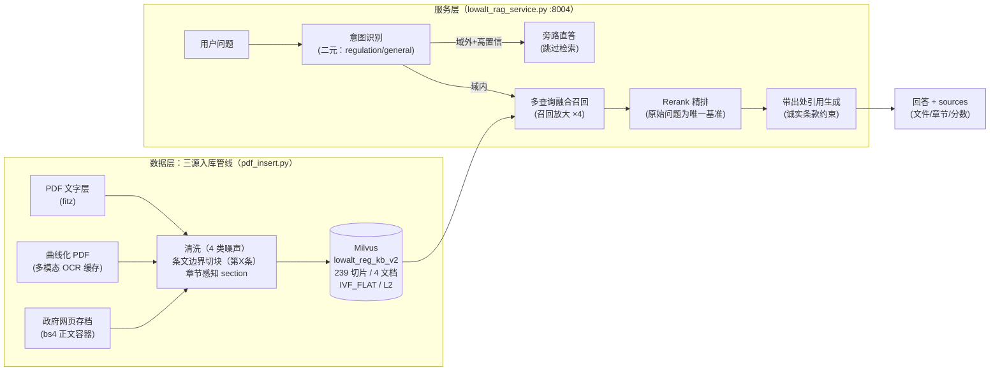

# LowAlt-Reg Copilot — 低空空域规章智能问答（RAG）

> 基于三级法规语料（国务院条例 / 民航局规章 / 四川低空试点）的检索增强问答服务：
> **两阶段检索（宽召回 + Rerank 精排）+ 条文级引用可查证 + 拒答优于幻觉**

- **检索命中**：消融实验（9 题评估集）top1 命中率 **44% → 78%**，top3 命中率 **67% → 100%**
- **回答可信**：10 问人工验收 **0 虚构条文、0 假引用**；参考资料不足时诚实拒答而非编造
- **评估体系**：RAGAS 自动化评估（LLM-as-judge）——faithfulness **0.75** / context_precision **0.89** / context_recall **0.89**（滑窗库基线；条文切块版对比数据重跑中）
- **引用可查证**：每条回答标注出处到"文件 + 章节 + 条款"级别（如 *依据 CCAR-92 B 章 第 92.51 条*）

## 效果数据

### 消融四象限：哪个模块真正有效？

控制变量实验（9 题固定评估集，指标 = 检索 top1/top3 命中预期条文所在章节）：

| 象限 | 查询扩展 | Rerank 精排 | top1 命中 | top3 命中 |
|---|---|---|---|---|
| A 基线 | ✗ | ✗ | 4/9 (44%) | 6/9 (67%) |
| B 仅精排 | ✗ | ✓ | **7/9 (78%)** | **9/9 (100%)** |
| C 仅扩展 | ✓ | ✗ | 3/9 (33%) | 6/9 (67%) |
| D 全开 | ✓ | ✓ | 7/9 (78%) | 9/9 (100%) |

三个反直觉的发现：

1. **精排贡献了全部增益**：hybrid 检索分数区分度差（0.35~0.53 挤在一起），Rerank 后命中项分数 0.965~1.000，排序质量质变
2. **查询扩展单独使用是负贡献**：多查询朴素分数融合存在系统性缺陷——以 Q7（"相向飞行如何避让"）为例，原始查询的正确命中（hybrid 0.384，语义鸿沟导致分数偏低）被扩展查询召回的高分结果（0.406）挤出 top1
3. **B ≈ D**：扩展在精排加持下无额外增益，且每题多花 ~20s——**用数据推翻了"扩展是检索主力"的预设**，当前题集规模下生产配置应关闭扩展

> 实验脚本：`ablation_experiment.py`（四象限 × 9 题，直接调用 Pipeline 跳过生成，控制变量见脚本注释）

### 代表性案例：语义鸿沟的完整修复链

同一条避让规则的三种表述：口语 **"相向飞行"** / 川规定 **"相向"** / 川运行规则 **"对头相遇"**——embedding 召回全部跨不过（目标切片 hybrid 排位第 7，top_k=5 直接漏掉）：

```
原始查询命中 → hybrid 0.384（排位第 7，被 top_k 截断）
  → 召回池放大 ×4（宽进）→ 候选池 20+
  → Rerank 以原始问题为唯一基准统一打分 → rel 0.994，top1
  → 回答精确引用两份文件第三十四条："两架航空器对头相遇时，应当各自向右避让"
```

### 10 问验收摘要（回答质量）

覆盖四级法规文档 + 跨文档效力题 + 域外旁路题：**8/10 带出处实质回答，2/10 诚实拒答**（拒答发生在检索 miss 时——拒答优于幻觉）；域外问题（如烹饪）被意图旁路干净跳过，不浪费检索。

### RAGAS 自动化评估（生成质量维度）

消融实验量化的是检索命中（人工标注的分类指标），RAGAS 用 LLM-as-judge 补齐生成质量维度（连续指标 0~1，judge = qwen3.8-27b，temperature=0）。同一批 9 题、生产配置（扩展 off + 精排 on，滑窗库基线）：

| 指标 | 含义 | 得分 |
|---|---|---|
| faithfulness | 答案每句陈述能否在检索内容中找到依据 | **0.749** |
| context_precision | 检索片段中相关项是否排在前面 | **0.890** |
| context_recall | 标准答案要点被检索内容覆盖的比例 | **0.889** |

- **交叉验证**：context_precision 0.890 恰落在消融 top1（78%）与 top3（100%）之间——人工命中标注与 LLM judge 两套独立体系互相印证，评估结论可信
- **Q1 修复实录**：唯一 recall=0 的题，真凶是展示层 300 字截断（超长定义条文进 prompt 前被砍）——取消截断后验证通过：五类 + 各类性能参数完整输出（第六十二条 1191 字全文进场）
- 已知局限：answer_relevancy 因 judge 端 n>1 采样兼容问题暂缺（详见踩坑记录）

> 评估脚本：`ragas_eval.py`（两阶段设计：collect 存样本 / eval 阅卷——被评数据与评估过程分离，调参重跑评估不重新生成答案）

### 切块策略对比：滑窗 vs 条文边界

入库切块是 RAG 数据质量的地基。两种策略在同一评估集上对比（同语料 / 同 embedding / 同检索参数 / 同 judge，**唯一变量 = 切块策略**；239 vs 236 块，量级公平）：

> ⚠ **更正（10-27 深夜）**：下表首轮对比数据存在混杂因素——实验当日服务端热重载静默失效，"条文边界"组实际仍查询滑窗库，表中差异为同库两轮波动而非切块效果。v2 库与切块实现本身无误（已单独验证：条文级 fragment 正常返回、Q1 截断问题修复生效）。严格对比重跑后将更新本表。

| 策略 | 规则 | faithfulness | context_precision | context_recall |
|---|---|---|---|---|
| 滑窗（基线） | 400 字窗口 + 80 重叠，不感知内容边界 | 0.749 | 0.890 | 0.889 |
| **条文边界（生产）** | "第X条"原子单元 + 同章短条合并 | **0.781** | **0.909** | 0.889 |

- **两升一平无下降**；但 9 题样本下均值差异温和（不具统计显著性）——决策依据还包括数字之外的产品价值：**引用粒度 = 检索粒度**（问"第三十四条"直接命中整条）
- **Q7 满分案例（0.846 → 1.000）**：完整条文在场 → 答案每条出处断言逐字可查证——条文切块设计目标的质变兑现
- **诚实的失败**：Q1（五类分类）context_recall 仍为 0——对比实验定位了真凶不在切块层，而在**展示层 300 字截断**（超长定义条文进 prompt 前仍被砍）+ 检索排序，已列入 Roadmap

> 实现注记：`ARTICLE_PAT` 双分支正则（中文数字条 + CCAR-92 节号条），行首锚定区分"条文开头"与"正文引用"（句中引用如"按照本规则第92.329 条…"不能切段）；DRY_RUN 空跑曾抓到 92.1001 四位节号漏匹配 bug，详见 `pdf_insert.py` 注释

## 架构



关键设计决策：

| 决策 | 理由 |
|---|---|
| Rerank 用**原始问题**而非扩展查询打分 | 精排要回答"哪个文档最能回答用户真正想问的"——基准必须唯一且忠于用户；多路各自打分再合并 = 退回分数不可比的老问题 |
| 召回放大 ×4 是精排的前提 | 目标切片 hybrid 排位第 7 而 top_k=5——没有放大的 rerank 是无米之炊 |
| 参考块带出处（source\|section）喂给 LLM | 模型才能回答"依据《XX》第五章第三十四条"；section 标签在入库时建立，在生成时兑现 |
| Prompt 诚实条款 + "不得虚构条文编号" | 法规问答的生命线是引用可信；实测模型会主动声明"参考资料未注明"而非编造 |
| Milvus 裸写而非 LangChain | 学习原理优先——链路每一环自己写过才知道哪坏（本项目 5 个真实检索 case 都是黑盒框架抓不到的）；LangChain 对照重写在 Roadmap |

## Quick Start

```bash
# 1. 基础设施：Milvus 四容器（etcd + MinIO + standalone + attu）
docker compose up -d

# 2. 依赖（Python 3.9）
pip install -r requirements.txt

# 3. 配置：复制 .env（DASHSCOPE_API_KEY，阿里云百炼）
#    embedding=qwen3.7-text-embedding-flash / rerank=qwen3.7-text-rerank / LLM=qwen3.8-27b

# 4. 语料入库（三源管线，幂等可重跑）
python pdf_insert.py          # 先 DRY_RUN=True 检查切片质量，再改 False 正式入库

# 5. 起服务（两个终端）
python milvus_api.py          # :8000 检索 API（/query 支持 collection 参数）
python lowalt_rag_service.py  # :8004 问答服务 → http://localhost:8004/docs

# 6. 验证 / 消融
python test_lowalt_mvp.py     # 10 问验收
python ablation_experiment.py # 消融四象限
```

## 语料（四级法规层级）

| 层级 | 文档 | 提取方式 | 切片 |
|---|---|---|---|
| 国家行政法规 | 《无人驾驶航空器飞行管理暂行条例》（国务院令第761号） | 多模态 OCR（文字被矢量曲线化的防拷贝件） | 37 |
| 民航局规章 | 《民用无人驾驶航空器运行安全管理规则》（CCAR-92部） | PDF 文字层 | 149 |
| 地方试点规定 | 《四川省低空空域协同管理与使用规定（暂行）》 | 网页存档解析（bs4 + 正文容器） | 27 |
| 地方运行细则 | 《四川省低空空域协同管理运行规则（暂行）》 | PDF 文字层 | 23 |

## 项目结构

```
pdf_insert.py            # 三源入库管线（提取/清洗/双策略切块：滑窗+条文边界/幂等/DRY_RUN）
lowalt_rag_service.py    # 问答服务：意图/扩展/两阶段检索/带出处生成（enable_rerank 等开关支持消融）
milvus_api.py            # 检索 API（:8000）：vector/keyword/hybrid + collection 参数
milvus_config.py         # schema（1024 维 IVF_FLAT/L2）与连接配置
milvus_insert.py         # md 入库与 embedding/keywords 基础设施
ablation_experiment.py   # 消融四象限实验（本文数据出处）
ragas_eval.py            # RAGAS 评估管线（collect 存样本 / eval 阅卷两阶段）
test_lowalt_mvp.py       # 10 问验收（评估集 + 四信号判定）
rag_service.py           # 前身：通用域增强版（消融对照组，保持原样）
rag_service_simple.py    # 前身：Simple RAG（双 bug 修复记录见 docs/）
docker-compose.yml       # Milvus 编排
学习进展与问题/           # 项目文档：规划、进展、踩坑记录
```

## 已知局限（诚实声明）

- **评估规模小**：9 题评估集（消融与 RAGAS 共用），统计意义有限；结论方向可信但数字会随题集变化（检索波动性实测存在）
- **同步阻塞**：requests 同步调用在 async 路由中阻塞事件循环（单用户无感，并发场景需换 httpx）
- **生成延迟**：长回答 ~130s（生成 token 量主导），SSE 流式与 prompt 收敛待做

## Roadmap

- [x] **RAGAS 自动化评估**（已完成）：faithfulness 0.749 / context_precision 0.890 / context_recall 0.889（judge = qwen3.8-27b，temperature=0）；answer_relevancy 因 judge 端 n>1 采样兼容问题暂缺
- [~] **条文边界切块**：实现完成且 Q1 修复验证生效（v2 库生产运行中）；首轮对比数据因热重载静默失效而作废，严格对比重跑中
- [x] **展示层 fragment 截断适配**（已完成）：取消两处定长截断（300/200 字），Q1 验证通过——五类 + 性能参数完整输出（第六十二条 1191 字全文进场）
- [ ] **SSE 流式 + 延迟优化**：增强管线接 /chat/stream；意图+扩展合并调用；httpx 异步化
- [ ] **Agent 化**：RAG 检索封装为工具 → qwen Function Calling → MCP Server
- [ ] **语料运营**：CCAR-92 配套咨询通告、四川 2024-2026 低空新政、规章版本效力管理
- [ ] **工程化**：pytest 测试 / GitHub Actions CI / 全栈容器化

---

*项目背景：作者在四川省低空空域运行服务中心实习期间发现一线人员翻查规章的痛点，选择以 RAG 方式解决。从学习项目（通用域 RAG）演进而来，完整演进记录见 `学习进展与问题/`。*
